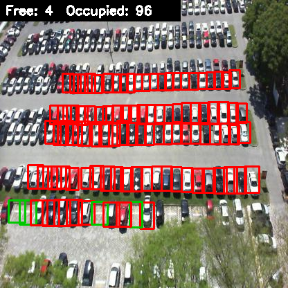
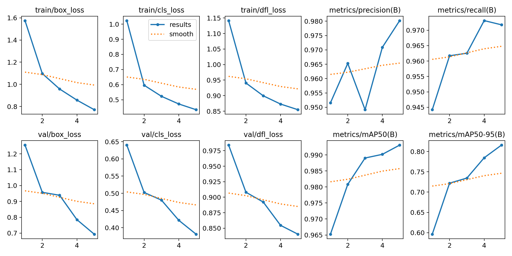
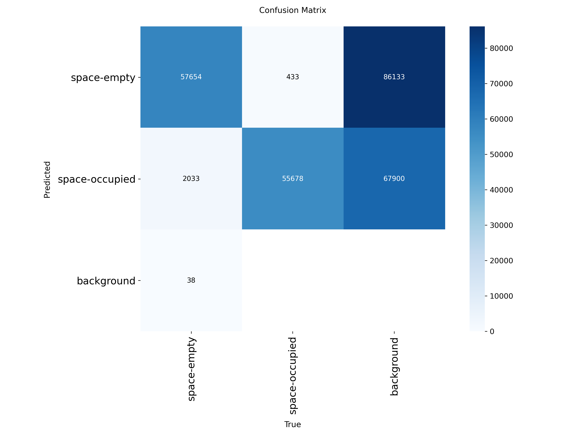
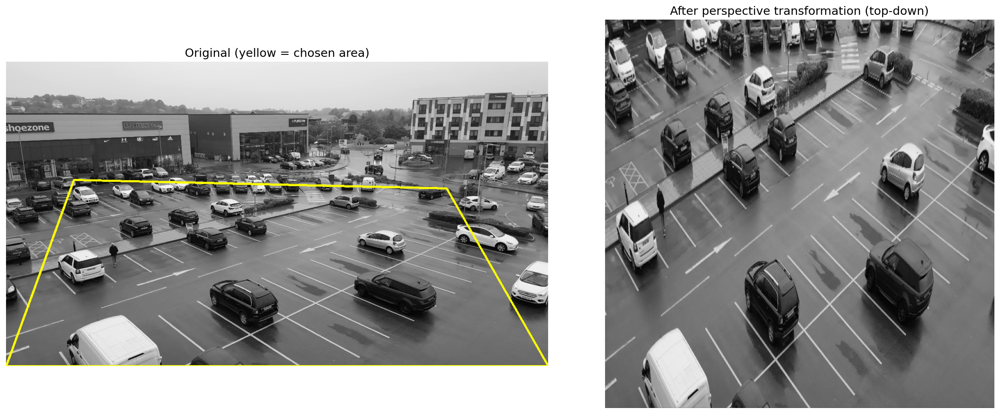

# Parking Space Detection

Detect parking spaces in camera images and video, and classify each space as **empty** or **occupied**.
Built for a Computer Vision course project.

**Topics covered:** image processing, perspective transformation, object detection, CNNs, video analysis, IoT.



---

## Goal

Drivers waste time searching for free parking. A fixed camera watching a parking lot can count free and
occupied spaces automatically and send the result to a sign, dashboard, or phone app.

## Pipeline

```
Camera image / video
   → Image processing (OpenCV: resize, perspective transformation)
   → YOLOv8 model (CNN): find each space + classify empty / occupied
   → Count free and occupied spaces
   → IoT message (MQTT, JSON) → dashboard / app
```

---

## Datasets

| Dataset | Used for | Size | Labels |
|---|---|---|---|
| **PKLot** (Almeida et al., 2015), Roboflow Universe copy | Detection + classification | 9,778 images (train 6,834 / valid 1,956 / test 988), 416×416 | Boxes: `space-empty`, `space-occupied` |
| **parking space 3** (Roboflow Universe) | Segmentation | 1,347 images (train 1,179 / valid 112 / test 56), incl. augmented copies | Polygons: `occupied`, `vacant` |

PKLot reference: Almeida, P., Oliveira, L. S., Silva Jr, E., Britto Jr, A., Koerich, A.,
*PKLot – A robust dataset for parking lot classification*, Expert Systems with Applications, 42(11):4937–4949, 2015. License: CC BY 4.0.

*parking space 3*: Roboflow Universe, by parkinglotdetectionteamcentaurus (project `parking-space-3-rwpgl`, version 3). License: CC BY 4.0.

---

## Results

### 1. Detection (main method) — YOLOv8n

Trained 5 epochs on a free Colab T4 GPU (~5.5 minutes). Tested on 988 unseen test images (57,436 spaces).

| Metric | Validation | Test |
|---|---|---|
| Precision | 0.980 | **0.979** |
| Recall | 0.972 | **0.976** |
| mAP50 | 0.993 | **0.992** |
| mAP50-95 | 0.816 | **0.818** |

| Class | Precision | Recall | mAP50 |
|---|---|---|---|
| space-empty | 0.990 | 0.962 | 0.992 |
| space-occupied | 0.969 | 0.990 | 0.993 |

**Speed:** 11.8 ms per image end-to-end (84.5 FPS) on a T4 GPU. Model size: 3.0 M parameters, 6.2 MB.

Validation and test scores are almost the same, so the model is not overfitting.




### 2. Classification — YOLOv8n-cls

Each labelled space is cut out and classified as empty or occupied (assumes space positions are known,
e.g. marked once when the camera is installed). Trained on crops from 200 PKLot images (11,228 crops), 5 epochs.

| Metric | Value |
|---|---|
| Test accuracy (3,828 spaces) | **0.978** |
| Time per space | 0.6 ms |
| Time per parking-lot image (~68 spaces) | 16.5 ms |
| Model size | 1.4 M parameters |

### 3. Segmentation — YOLOv8n-seg

Draws the exact outline of each space. Trained 20 epochs (~11 minutes) on the *parking space 3* dataset.
Tested on 56 images (1,274 spaces).

| | Box | Mask (outline) |
|---|---|---|
| Precision | 0.914 | **0.899** |
| Recall | 0.827 | **0.808** |
| mAP50 | 0.922 | **0.905** |

Mask mAP50 by class: occupied 0.948, vacant 0.863. Speed: ~38 ms per image (640 px). Model size: 3.4 M parameters.

### Comparison of the three methods

| | Classification | **Detection** | Segmentation |
|---|---|---|---|
| Output | Label per space | Box + label | Exact outline + label |
| Main score | Accuracy 0.978 | **mAP50 0.992** | Mask mAP50 0.905 |
| Speed (per image) | 16.5 ms (~68 spaces) | **11.8 ms** | ~38 ms |
| Needs spaces marked by hand | Yes | No | No |
| Handles slanted rows | Yes | Boxes overlap | Yes |

**Conclusion:** detection is the best main method (highest score, fast, finds spaces automatically).
Classification is just as accurate and smaller, but needs a manual map of spaces for every camera.
Segmentation gives the most precise shapes but is slower and needs polygon labels.
Note: segmentation was tested on a different, smaller dataset, so its score is not a fully fair comparison.

---

## Video analysis

- **PKLot time-lapse:** 150 test images turned into a video with live free/occupied counts (processed in 8 s).
- **New parking lot (UK video, 4K):** detection runs every 15 frames to save time (227 frames in 17.6 s).

Videos are kept locally (not uploaded to GitHub because of file size).

## Perspective transformation

Four corners of the parking area are chosen on a slanted camera view, and OpenCV
(`getPerspectiveTransform`, `warpPerspective`) flattens the area into a top-down view.



## IoT design

```
Camera → Edge device (e.g. Raspberry Pi) running YOLOv8n → MQTT → Cloud broker → Dashboard / App / LED sign
```

Example message (topic `parking/LOT-A/status`):

```json
{
  "lot_id": "LOT-A",
  "camera_id": "CAM-01",
  "timestamp": "2026-11-15T19:47:50",
  "free_spaces": 60,
  "occupied_spaces": 40,
  "occupancy_rate": 0.4
}
```

Only counts are sent (about 150 bytes), not video: low bandwidth and better privacy.
The model is exported to **ONNX** (12.1 MB) for deployment on small devices.

---

## Limitations

- **Domain shift:** on a new parking lot (UK video, low camera angle, black & white), the model found almost
  no spaces. Perspective transformation helped only slightly (0–1 → 2 spaces found).
- PKLot images are from 2012–2013, two lots in Brazil, daytime only, no snow.
- Upright boxes overlap on slanted spaces in angled camera views.
- Speed was measured on a GPU; an edge device will be slower (checking every few seconds is enough for parking).

## Future work

- Fine-tune on images from the target parking lot (e.g. a local Alberta lot, including winter / snow).
- Rotated boxes (YOLOv8-OBB) for slanted spaces.
- Test on CNRPark-EXT and on real edge hardware (Raspberry Pi / Jetson Nano).
- Live dashboard receiving the MQTT messages.

---

## How to run

1. Open `notebooks/parking_space_detection_yolo.ipynb` in Google Colab.
2. **Runtime → Change runtime type → T4 GPU**.
3. Add your Roboflow API key in Colab **Secrets** (🔑) with the name `ROBOFLOW_API_KEY` and turn on notebook access.
4. Run the cells from top to bottom.

## Folder structure

```
notebooks/   Colab notebook (all steps)
results/     charts, confusion matrix, detection / segmentation / perspective examples
models/      trained models (best.pt, best.onnx, seg_best.pt) — kept locally, not uploaded
data/        dataset — downloaded in Colab, not uploaded
```

## Tools

Python, Ultralytics YOLOv8, PyTorch, OpenCV, Roboflow, Google Colab (T4 GPU), Matplotlib.
